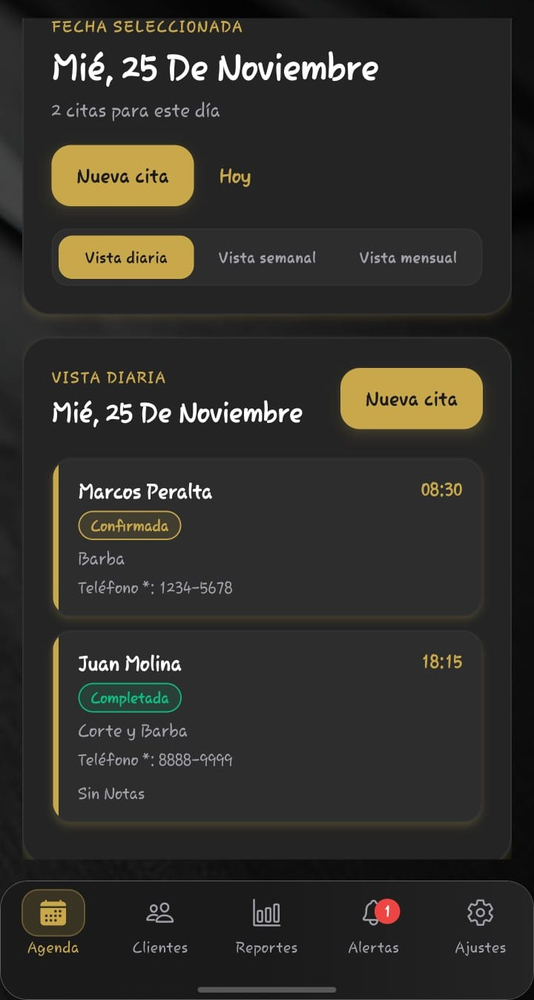
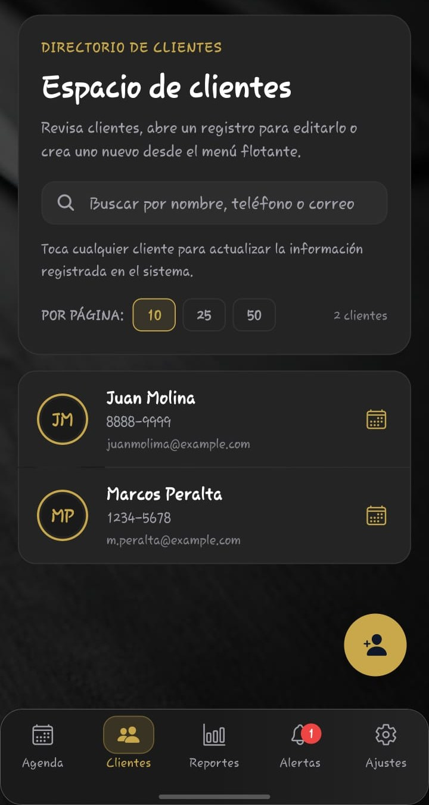
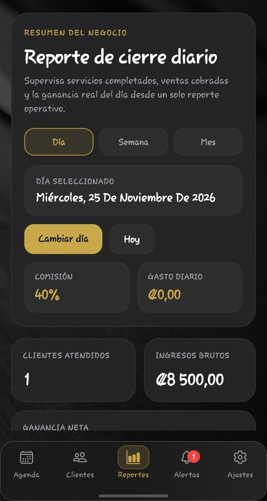
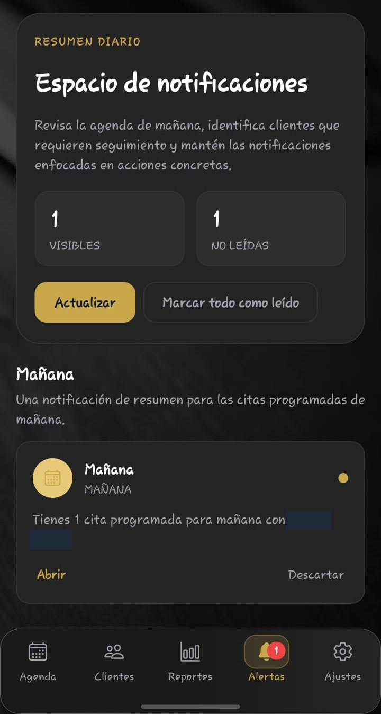
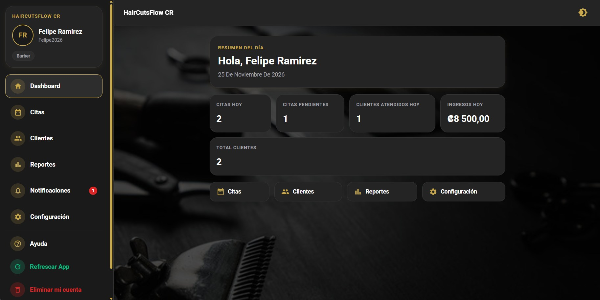
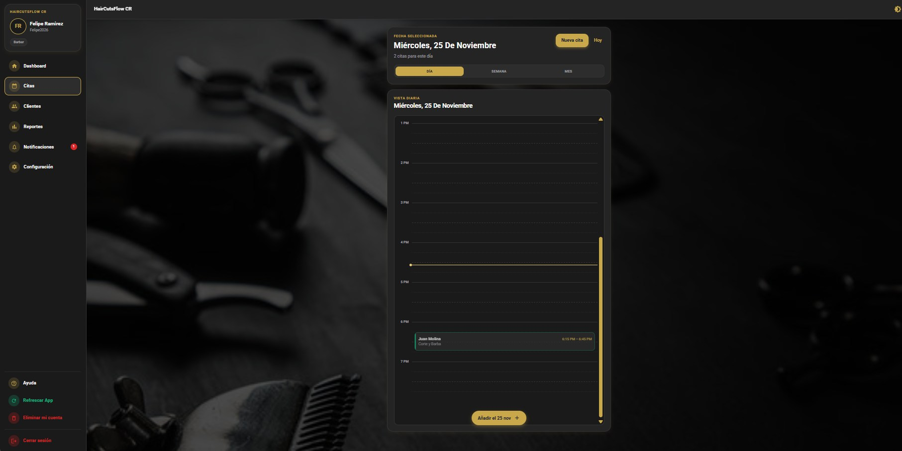
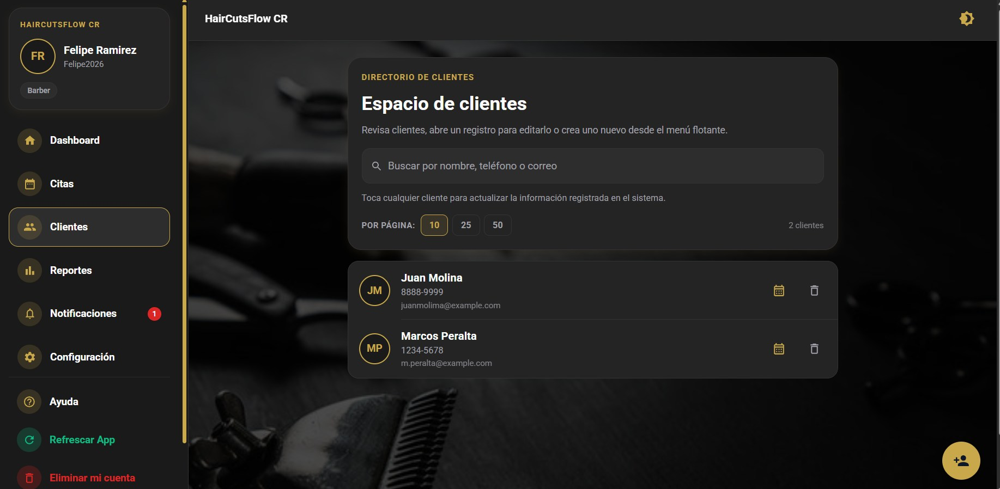
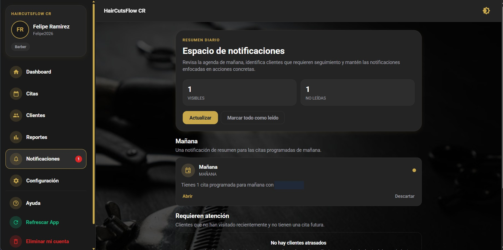
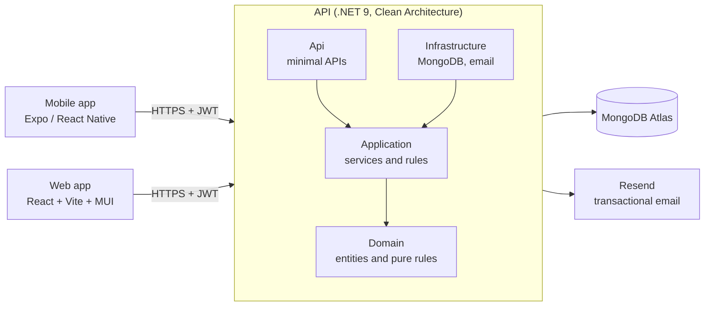
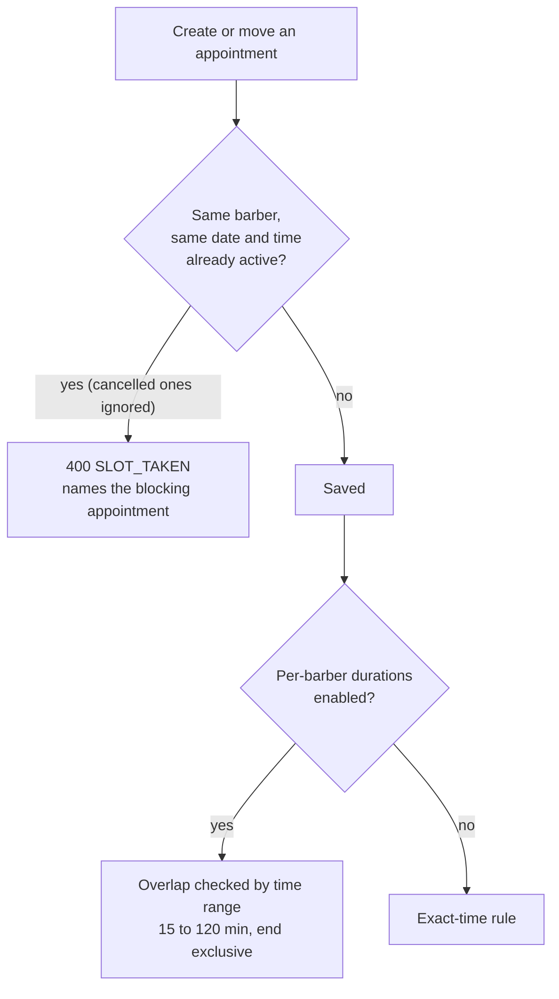

# HairCutsFlow CR

**A management platform for independent barbers in Costa Rica: appointments, clients, earnings reports and reminders, in a mobile app and a web app backed by one API.**

> **This is the public showcase of a private, commercial project.** The source code is not published here. All rights reserved; see [`LICENSE`](LICENSE).

Live: the product site is at [www.haircutsflowcr.com](https://www.haircutsflowcr.com) (privacy policy: [/privacy-policy](https://www.haircutsflowcr.com/privacy-policy)).

## At a glance

| | |
|---|---|
| **Built in** | ~10 months of git history (Jan 14 to Nov 25, 2026) |
| **Delivered through** | 148 merged pull requests, 320+ commits |
| **Code** | 45,000+ lines of C# and TypeScript across the API, the web app and the mobile app |
| **Automated tests** | 400+ backend tests (domain, application, integration against a real embedded MongoDB, endpoints end to end) and about 60 web tests |
| **API** | 40 REST endpoints |
| **Surfaces** | REST API, web app (landing and dashboard), mobile app (16 screens) |
| **Status** | API and web running in production; the mobile app is distributed as an installable build and is not on the app stores yet |

## The problem

An independent barber runs the business out of notebooks, chat threads and a calculator: appointments get double-booked, a client who has not been back in weeks is only noticed by chance, and at the end of the day nobody knows the real profit once the commission and the fixed expenses are taken out.

HairCutsFlow CR puts the schedule, the client book and the closing numbers in one place that works on the phone and on the computer, in Spanish, in colones, and with **SINPE Móvil** as a first-class payment method.

## How it works

1. The platform owner creates the barber's account (there is no self-signup: access is sold, not open).
2. The barber signs in on the phone or the web and registers clients (duplicates by phone number are caught).
3. Appointments go into a day, week or month calendar. The system refuses a time the barber already has booked, and can create weekly, biweekly or monthly series when the owner enables them for that barber.
4. When the cut is done, the barber marks the appointment as completed with the price and how it was paid.
5. Daily, weekly and monthly reports show gross revenue, the barber's commission, the fixed expense and the net profit, with a breakdown by payment method and a day-by-day detail.
6. The app reminds the barber of tomorrow's appointments and of clients who have not returned in 30+ days.

## Screenshots

Taken from a test account with demo data (a real-looking client name is covered).

### Mobile app

| Calendar | Clients | Daily report | Notifications |
|---|---|---|---|
|  |  |  |  |

### Web app

| Dashboard | Calendar (day view) |
|---|---|
|  |  |

| Clients | Notifications |
|---|---|
|  |  |

## Architecture

Dependencies point inward: the application layer owns the interfaces and the infrastructure implements them, so every repository has a MongoDB and an in-memory implementation chosen by configuration. That is what lets the endpoint tests run without a database.

A new appointment goes through a single scheduling rule:

## Engineering highlights

| Concern | Approach |
|---|---|
| **Tenant isolation** | Every appointment and client belongs to the barber who created it, and every query and every by-id lookup is scoped to that owner. Another barber's resource answers **404**, not 403, so the API never confirms that an id exists. |
| **Authentication** | JWT access tokens with a short lifetime and refresh tokens stored only as SHA-256 hashes. Passwords are hashed with BCrypt, and a hash scheme change is rolled out transparently at each account's next successful login, with no downtime and no migration script. |
| **Account recovery** | One-time codes from a cryptographically secure generator that expire in 15 minutes, and a "forgot password" response that is identical whether or not the account exists. |
| **Abuse protection** | Rate limiting on the authentication endpoints, a global exception handler that never leaks internals, an allow-list CORS policy, and Swagger only in development. |
| **No double booking** | The scheduling rule is evaluated per barber and re-checked on create, move, edit, resize and on every occurrence of a recurring series. |
| **Recurring series** | Capped by a server-side setting only the owner can change; monthly series are always computed from the original date, so a series that starts on the 31st does not drift to the 28th. |
| **Duplicate clients** | Phone numbers are normalised (`8888-0000`, `88880000` and `+506 8888 0000` are the same) and a partial unique index closes the race between two simultaneous requests. |
| **Reports that add up** | Commission is rounded per day, so a week or a month equals the sum of its days to the cent. The fixed daily expense is subtracted only up to today, and "today" is Costa Rica time (UTC-6, no daylight saving), independent of the server clock. |
| **Feature flags per barber** | Adjustable appointment durations and recurring appointments are opt-in per account and off by default, so existing barbers see no change when a feature ships. |
| **Account deletion** | Deletes all of an account's data in a safe order (appointments, clients, shop, profile, tokens) and the login last, so a failure halfway leaves an account that can still sign in and retry. |
| **Mobile security** | Session token in the platform keystore (Keychain / Keystore), biometric lock on reopening, and the local cache is wiped on sign-out and on account deletion. |
| **Contract discipline** | An API change must update the types of both frontends in the same change. |

## Tech stack

| Area | Technology |
|---|---|
| **Backend** | .NET 9, C#, minimal APIs, MongoDB (`MongoDB.Driver`), JWT bearer, BCrypt, FluentValidation, ASP.NET Core rate limiting |
| **Web app** | React 19, TypeScript, Vite, MUI 6, layered Clean Architecture, Vitest |
| **Mobile app** | Expo SDK 54, React Native, TypeScript, Zustand, secure storage and biometric authentication, EAS builds |
| **Email** | Resend (transactional) |
| **Hosting** | Railway (API and web), MongoDB Atlas, Cloudflare (DNS and access control for the staging site) |
| **CI/CD** | GitHub Actions: checks on every pull request, automatic deploy of the staging and production environments |
| **Testing** | xUnit, Moq, an embedded MongoDB for repository tests, ASP.NET Core `WebApplicationFactory` for endpoints |

## Features

- **Agenda:** day, week and month views, status per appointment (scheduled, confirmed, completed, cancelled), recurring appointments, and an optional hourly day view with drag-to-move on mobile.
- **Clients:** contact details, preferences and payment method, quick search by name or phone, appointment history, duplicate detection.
- **Reports:** daily, weekly and monthly; revenue, commission, fixed expense, net profit; breakdown by payment method; day-by-day detail.
- **Payments recorded per appointment:** cash, SINPE Móvil, bank transfer and card.
- **Notifications:** tomorrow's agenda and clients who have not returned in a month or more, computed on the device in the mobile app.
- **Platform administration:** the owner creates, edits and blocks barber accounts (for example for non-payment) and tunes each barber's settings.
- **Accounts:** sign-in, password recovery by emailed code, and in-app account deletion.
- **Public pages:** a landing page and a privacy policy (the policy is published in Spanish and English).

## Quality and delivery

- **Tests at every layer:** pure domain rules, application services with substituted repositories, repositories against a real embedded MongoDB, and the HTTP endpoints end to end.
- **Pipeline:** every change enters through a pull request, and a repository ruleset requires the CI checks to pass before merging into `develop` or `main`. The CI detects which app a change touches and skips the jobs for the rest, so a documentation-only change costs no build minutes. Merging deploys the API to its environment automatically.
- **Environments:** local, staging (`develop`) and production (`main`), each with its own database and its own deploy token.
- **Documentation:** one reference document covering the product, operations, API, web and mobile, kept in the same pull request as the behaviour it describes.

## How it is built: AI-assisted development

Most of this project was implemented with AI-assisted development using Claude Code. The human role is the product and engineering direction; the assistant does much of the typing.

- **Decisions stay human:** product rules, architecture, the security model and the trade-offs.
- **Written rules guide the assistant:** a project instruction file records the conventions (tenant boundary, layering, how to update the contracts and the docs).
- **Quality gates, not trust:** pull requests, CI, tests against a real database, type checking and linting.
- **Reviewed, not pasted:** changes are read, questioned and corrected; security-sensitive areas (authentication, tokens, rate limiting, tenant isolation) get explicit review and tests.

## Status and roadmap

The API and the web app are running in production. The mobile app is installable as a build but is not published on Google Play or the App Store yet.

**Next:** publish the mobile app on the stores, bring adjustable appointment durations to mobile (the API and web already have them), and add a CI job for the mobile app.

## Contact

The source code is private. For hiring conversations or a technical walkthrough, reach out through my [GitHub profile](https://github.com/gramirez29), where access to the repository can be arranged on request.
